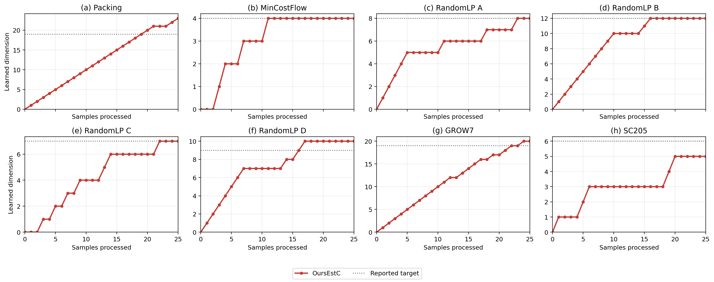
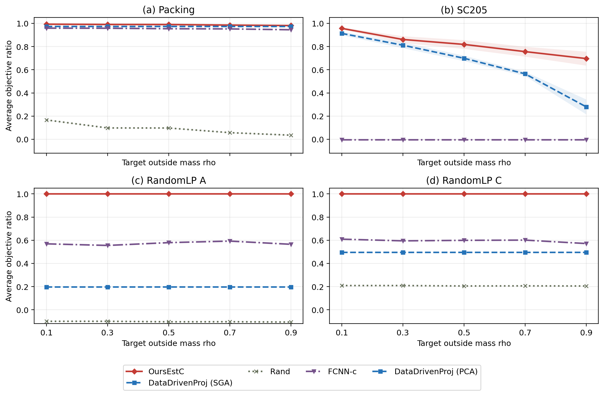
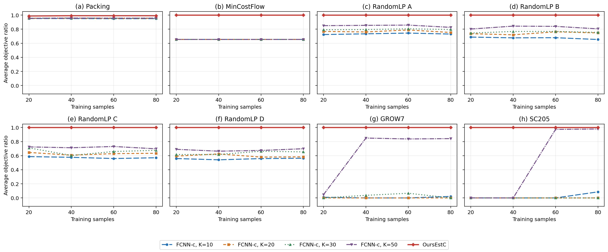
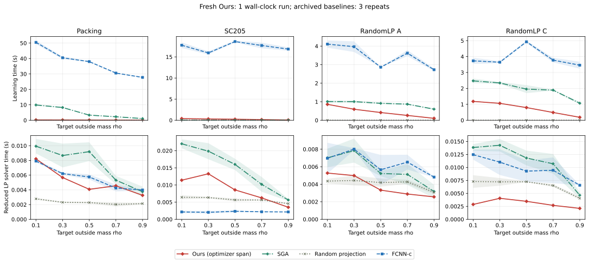
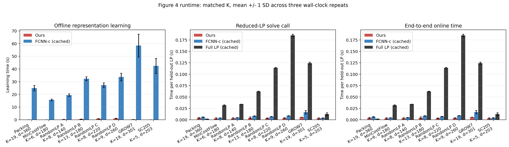

# LP and IP Compression Experiments

This repository combines the original anonymous LP reproduction package with
the unit-commitment and knapsack experiments in Appendix C.3.

## IP experiments

The [`ip/`](ip/) directory contains the code, synthetic data, fitted models,
and test results for the current Tables 3 and 4. It includes Full, Ours, SVM,
Neural Diving, MLOPT, and Preference Learning, together with the additional
Neural Diving training experiment.

Verify the bundled files and reproduce the tables without retraining:

```bash
python ip/run.py verify-artifacts
python ip/validate_results.py
```

See [`ip/README.md`](ip/README.md) for installation, model evaluation,
training commands, and definitions of recovery, objective ratio, and learning
time. New runs write to separate output directories and leave the recorded
experiments unchanged.

On Windows, enable long paths when cloning the archived directory layout:

```bash
git clone -c core.longpaths=true https://github.com/yeyuhanyyh/submission-20324-reproducibility-source.git
```

## Original LP experiments

The LP code and recorded results below are from the original anonymous
release for Figures 2–4 and their runtime benchmarks. The original scripts,
data, and results retain their existing paths.

### Setup

Tested with Python 3.14 on Windows and CPU:

```bash
python -m pip install -r requirements.txt
```

SciPy/HiGHS solves all LPs on CPU. CUDA can accelerate FCNN tensor operations,
but not the LP solves.

### Reproduce Figures 2-4

Run the one-click reproduction:

```bash
python reproduce_figures.py
```

This command validates the bundled results and regenerates Figures 2-4. For a
quick plot-only pass, use:

```bash
python reproduce_figures.py --plot-only
```

To recompute experiments from the included implementations, use:

```bash
python reproduce_figures.py --rerun --only figure2
python reproduce_figures.py --rerun --only figure3
python reproduce_figures.py --rerun --only figure4
```

To rerun all three figures sequentially:

```bash
python reproduce_figures.py --rerun
```

Complete Figure 3 and Figure 4 neural workloads can take several hours on a
laptop CPU.

| Experiment | Raw results | Figure |
|---|---|---|
| Figure 2 | `results/fresh/figure2_rank_growth_raw.csv` | `figures/figure2_fresh_rank_growth.png` |
| Figure 3 | `results/fresh/figure3_timing_raw.csv` | `figures/figure3_fresh_legacy_execution.png` |
| Figure 4 | `results/fresh/figure4_timing_raw.csv` | `figures/figure4_fresh_legacy_execution.png` |

### Runtime

Run the three-repeat timing benchmark:

```bash
python benchmark_runtime.py --scope all --repeats 3 --force
```

Run one timing experiment:

```bash
python benchmark_runtime.py --scope figure3 --repeats 3 --force
python benchmark_runtime.py --scope figure4 --repeats 3 --force
```

The implementation of our method is in `code/core/ours.py`. For each training
cost, it solves the full LP once and constructs the span of optimizer
differences. Figure 4 timing uses the same reduced dimension for our method and
FCNN-c.

Raw timing results are written to `results/timing/`, and the plots are written
to `figures/`.

### Example Outputs

#### Learned Dimension



#### Figure 3: Objective Ratio versus Prior Misspecification



#### Figure 4: Objective Ratio versus Training Samples



#### Figure 3 Runtime



#### Figure 4 Runtime



### Experimental Protocol

Figure 2 processes training prefixes from 0 to 25 samples on Packing,
MinCostFlow, RandomLP A-D, GROW7, and SC205.

Figure 3 uses 40 training LPs and
`rho = 0.1, 0.3, 0.5, 0.7, 0.9`. Packing, RandomLP A, and RandomLP C use SGA;
SC205 uses PCA.

Figure 4 uses training sizes `20, 40, 60, 80` and FCNN-c dimensions
`K = 10, 20, 30, 50`. Complete settings are defined in `code/experiments/`
and the corresponding runner scripts.

### Package Layout

- `reproduce_figures.py`: one-click reproduction and plotting entry point.
- `benchmark_runtime.py`: repeated timing entry point.
- `code/core/ours.py`: implementation of our method.
- `code/core/`: LP, projection, SGA/PCA, and FCNN-c implementations.
- `code/experiments/`: instance, prior, and training-protocol definitions.
- `code/runners/`: Figure 2-4 and runtime drivers.
- `data/netlib/selected/`: GROW7 and SC205 MPS files.
- `data/checkpoints/figure4_netlib_k50/`: Netlib FCNN-c checkpoints.
- `results/fresh/`: raw results used by the accuracy figures.
- `results/timing/`: raw timing results.
- `figures/`: generated plots.
